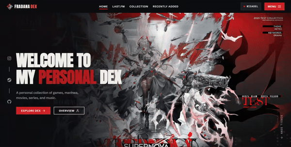
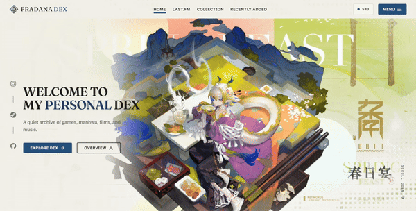

# Media-Dex

A personal media catalog and live Last.fm listening archive for favorite games, manga, manhwa, movies, series, and music. Built with zero-build vanilla web standards, inspired by Arknights operators Wisadel and Shu.

**Live Demo:** [https://afif25fradana.github.io/Media-Dex/](https://afif25fradana.github.io/Media-Dex/)

---

## About

This is my personal media dex for tracking played games, reading list, watchlist, and repeat playlists, with all entries maintained by hand in `data.json`.

---

## Features

- **Dual Operator Themes**: Wisadel (tactical obsidian dark) and Shu (warm rice-paper light).
- **Live Last.fm Turntable**: Real-time vinyl player showing currently scrobbling tracks and 30-day top rotation.
- **Native Dialog Modals**: Item details and curator profile modal powered by native `<dialog>` with keyboard focus traps and zero-CLS avatar loading.
- **Zero Build Step**: Native ES modules and 3-way modular CSS (`tokens.css`, `base.css`, `sections.css`) running directly in the browser.

---

## Quick Start

Browsers block ES module imports and JSON fetches on `file://` URLs, so serve the files over static HTTP.

### Running Locally

```bash
# Using Python 3
python -m http.server 3000

# or using Node
npx serve .
```

Open `http://localhost:3000` in your browser.

### Running Tests

```bash
node --test tests/dex.test.mjs
```

---

## Showcase

<p align="center">
  
  
</p>
