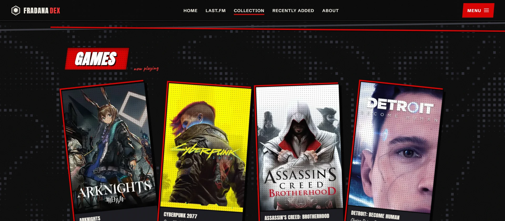

# Media-Dex

A personal catalog and live Last.fm telemetry archive for favorite games, manga, manhwa, movies, TV series, and music. Built with zero-build vanilla web standards, inspired by the tactical and serene visual aesthetics of Arknights operators (Wisadel & Shu).

**Live Demo:** [https://afif25fradana.github.io/Media-Dex/](https://afif25fradana.github.io/Media-Dex/)

## Why It Exists

Media-Dex serves as a personal archive and public showcase for curated media taste. Rather than managing complex build pipelines or framework dependencies, this project is built entirely on native browser primitives—serving pure ES modules, custom elements with Shadow DOM, and responsive media directly over static HTTP.

The visual interface is anchored by a dual-operator design system:
- **Wisadel** (default): Tactical editorial with an obsidian canvas (`#090A0D`), crimson accent (`#D01E25`), sharp corners, and bold Anton display headlines.
- **Shu** (secondary): Serene agricultural editorial with a deep ink canvas (`#0C110F`), celadon/sage accent (`#529B77`), rounded corners, and Fraunces serif typography.

## Quick Start

Because the project uses native ES modules and fetches `data.json`, it must be served over HTTP rather than opened directly via `file://`.

### Running Locally

```bash
# Using Python 3
python -m http.server 3000

# or using Node
npx serve .
```

Open `http://localhost:3000` in your browser.

### Running Tests

The test suite runs headlessly using Node's built-in test runner (`node:test`) with zero external npm dependencies:

```bash
node tests/dex.test.mjs
```

## Architecture & Features

- **Zero-Build Vanilla ES Modules**: Runs natively in modern browsers with no bundlers, transpilers, or node_modules dependencies.
- **Dual-Operator Theme Switcher**: Toggle between Wisadel and Shu visual themes via a responsive navbar switch. The selection is persisted in `localStorage` under `media-dex-operator` and applied synchronously via an inline `<head>` script to prevent flash-of-unstyled-theme (FOUC/FOTC).
- **Web Components (Shadow DOM)**: Custom elements (`<dex-card>`, `<dex-empty-state>`) encapsulate layout and cover presentation while inheriting theme tokens dynamically via flat-tree CSS custom properties without requiring custom pseudo-elements.
- **Responsive Hero Media Slot**: High-performance hero section featuring looping WebM video and static WebP poster fallbacks, blended seamlessly against the canvas ground using CSS radial mask vignetting (`radial-gradient`) to prevent video boundary seams and Safari/iOS alpha artifacts. Full autoplay rejection handling and graceful fallback to static posters on `prefers-reduced-motion: reduce`.
- **Live Last.fm Telemetry**: Real-time turntable integration displaying currently playing tracks, recent scrobbles, and 30-day listening statistics fetched client-side with cache guards and sanitized SVG cover rendering.
- **Accessible & Plumb-Aligned**: Zero skew transforms or tilted cards; plumb-level 0° alignment with subtle 2px hover lifts, full keyboard roving tabindex navigation across category tabs, W3C APG ARIA announcements, and complete reduced-motion overrides.

## Showcase

<p align="center">
  
  
</p>

<p align="center">
  
</p>
