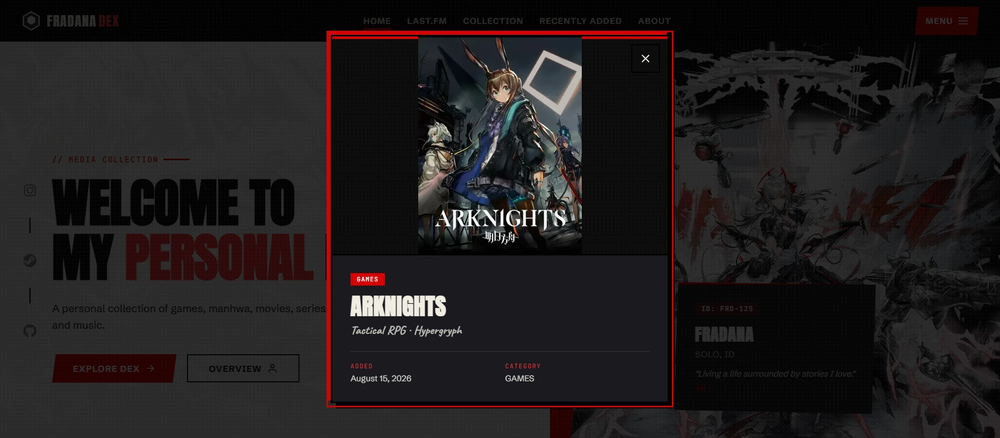
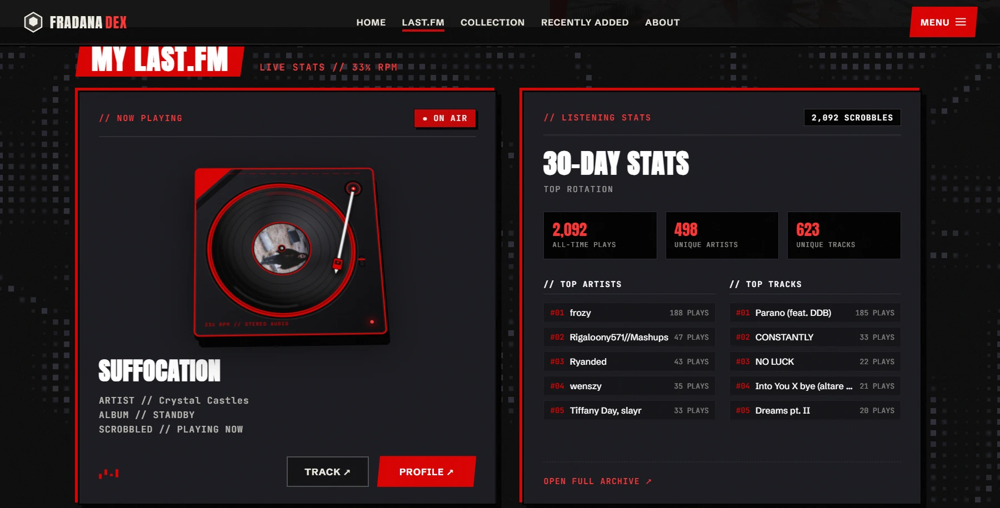

# Media-Dex

A personal media catalog and live Last.fm listening telemetry archive for favorite games, manga, manhwa, movies, TV series, and music. Built on zero-build vanilla web standards, inspired by the tactical and serene aesthetics of Arknights operators Wisadel and Shu.

**Live Demo:** [https://afif25fradana.github.io/Media-Dex/](https://afif25fradana.github.io/Media-Dex/)

## Overview

Media-Dex is a personal media showcase and listening archive. Built on modern browser primitives with zero build tooling, the application uses native ES modules, custom elements with Shadow DOM, and responsive media served over static HTTP.

The interface switches between two operator themes:
- **Wisadel (Default)**: Tactical editorial with an obsidian canvas (`#090A0D`), crimson accent (`#D01E25`, hover `#B5181E`), sharp `0px` corners, and bold Anton display headlines under `color-scheme: dark`.
- **Shu — Spring Feast (Secondary)**: Serene agricultural editorial with a warm rice-paper canvas (`#F5F2EB`), Cobalt River Blue primary accent (`#1F4E79`, hover `#163A5C`), Ceremonial Gold secondary (`#C59B27`, text `#876013`), Vermilion Seal Stamp tertiary (`#B63925`), celadon isoline dot texture (`#E6ECD6`..`#9FB885`), soft `4px–8px` rounded corners, and Fraunces serif headlines under `color-scheme: light`.

Catalog entries are maintained by hand in `data.json`.

## Quick Start

Because browsers block ES module imports and JSON fetches on `file://`, the project must be served over HTTP.

### Running Locally

```bash
# Using Python 3
python -m http.server 3000

# or using Node
npx serve .
```

Open `http://localhost:3000` in your browser.

### Running Tests

The test suite runs with Node's built-in test runner (`node:test`) without external dependencies:

```bash
node --test tests/dex.test.mjs
```

The runner executes 9 passing tests, verifying utility sanitizers and sorters, `data.json` schema rules, disk asset existence, modular stylesheet architecture (3 files, zero `@import` rules, zero legacy `src/style.css`), and `<head>` metadata bootstrap synchronization.

## Architecture & Scope

- **Zero-Build Vanilla ES Modules**: Runs directly in modern browsers without bundlers, transpilers, or npm runtime dependencies.
- **3-Way Modular CSS Architecture**: Styles are split into three parallel stylesheets (`src/styles/tokens.css`, `src/styles/base.css`, `src/styles/sections.css`) with zero `@import` rules, replacing the monolithic `src/style.css`.
- **Dual-Operator Theme Engine**: Toggles between Wisadel and Shu themes from the navigation bar. Selection persists in `localStorage` (`media-dex-operator`) and is applied by a synchronous inline `<head>` bootstrap script to prevent flash-of-unstyled-theme (FOUC).
- **Mobile & Platform Meta Synchronization**: Dynamically synchronizes `<meta name="theme-color">` (`#090A0D` vs `#F5F2EB`) and `<meta name="color-scheme">` (`dark` vs `light`) at load and theme toggle, matching browser chrome to the active theme.
- **Fluid Halftone Background Engine**: Canvas-based topographic background driven by 3D Perlin noise and domain warping. Reacts to `operatorchange` events to switch palettes between Wisadel obsidian (`#070707`) and Shu celadon isolines (`#E6ECD6`..`#9FB885`), with static single-frame rendering under `prefers-reduced-motion: reduce`.
- **Web Components (Shadow DOM)**: Custom elements (`<dex-card>`, `<dex-empty-state>`) encapsulate layout and presentation while inheriting theme tokens across the shadow boundary via flat-tree CSS custom properties.
- **Responsive Hero Media Slot**: Hero media section featuring looping WebM video and static WebP poster fallbacks, blended with a CSS radial mask vignette (`radial-gradient`) to eliminate video boundary seams and Safari/iOS alpha artifacts. Includes autoplay rejection recovery, video decoder teardown on operator change, and static poster fallback for `prefers-reduced-motion: reduce`.
- **Live Last.fm Telemetry**: Real-time turntable displaying currently playing tracks, recent scrobbles, and 30-day listening stats. The vector turntable SVG adapts to the active theme through CSS custom properties without reloading images.
- **Keyboard Navigation & Accessibility**: Level 0° card alignment with 2px hover lifts, keyboard roving tabindex across category tabs, W3C APG ARIA announcements, and system-wide reduced-motion overrides.

## Showcase

<p align="center">
  
  
</p>

<p align="center">
  
</p>
