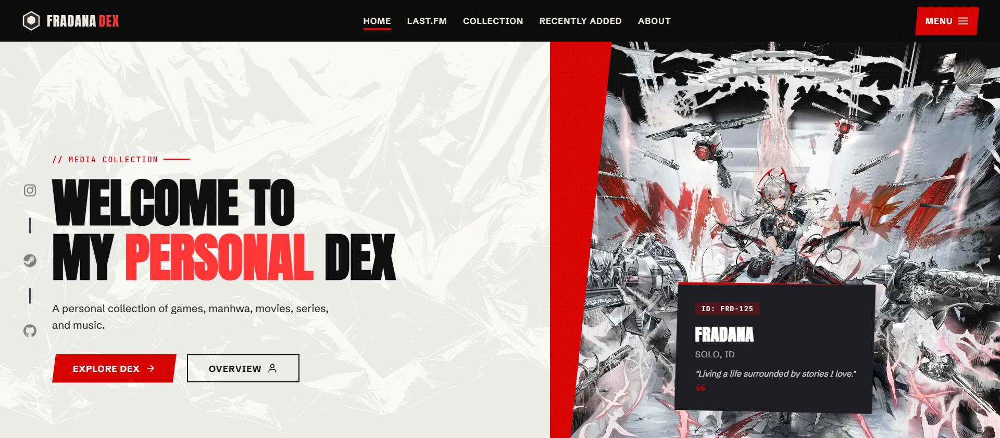
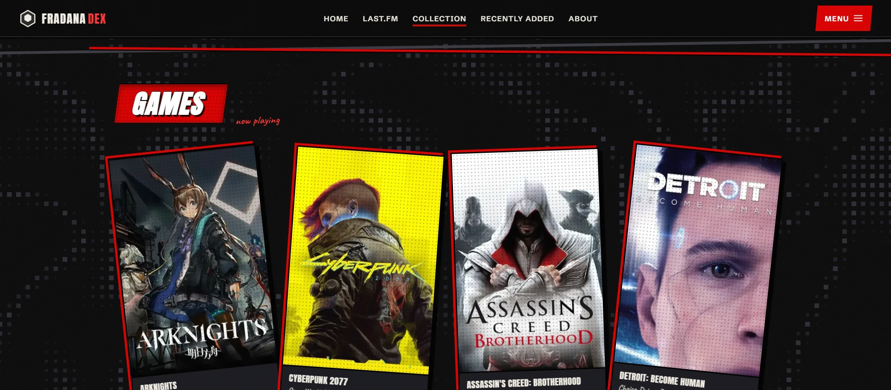
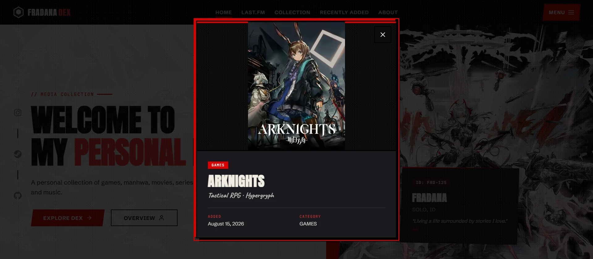
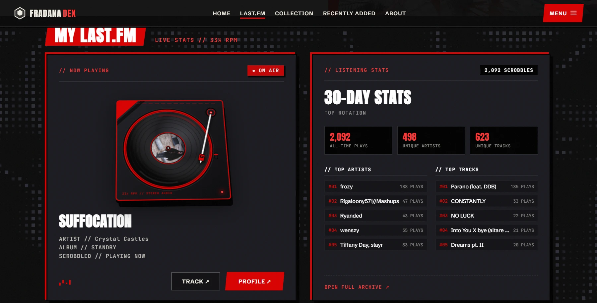

# Media-Dex

A personal catalog of favorite games, manga, manhwa, movies, TV series, and music. Built for fun and archiving, inspired by the Persona 5 interface.

**Live Demo:** [https://afif25fradana.github.io/Media-Dex/](https://afif25fradana.github.io/Media-Dex/)



## Showcase

<p align="center">
  
  
</p>

<p align="center">
  
</p>

## Stack

- Plain HTML5, CSS, and Vanilla JavaScript (ES modules)
- Custom Web Components (`<dex-card>`, `<dex-empty-state>`)
- Vanilla web technologies with no npm packages or build step

## Running Locally

Because the project uses ES modules and fetches `data.json`, it must be served over HTTP rather than opened directly as a file:

```bash
# Python 3
python -m http.server 3000

# or Node
npx serve .
```

Open `http://localhost:3000` in your browser.
